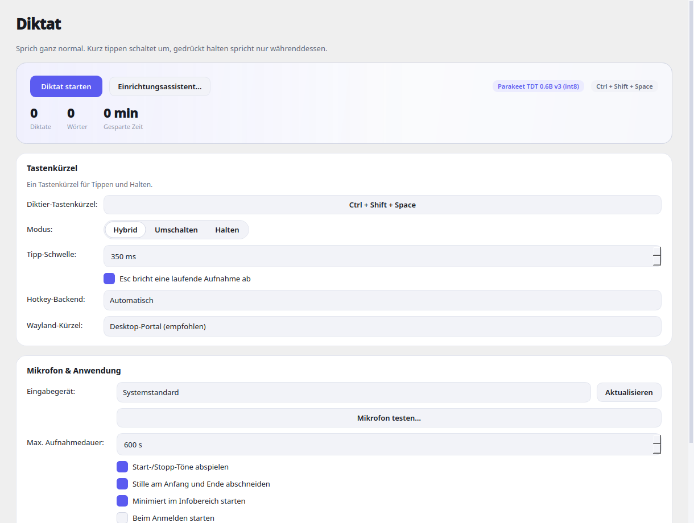
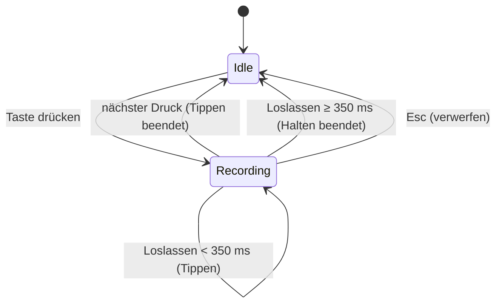
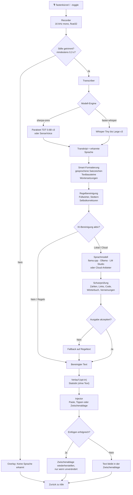
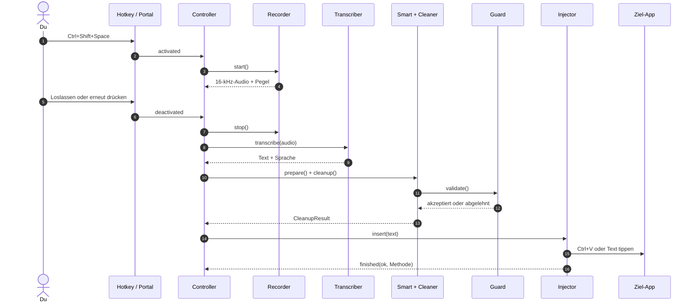
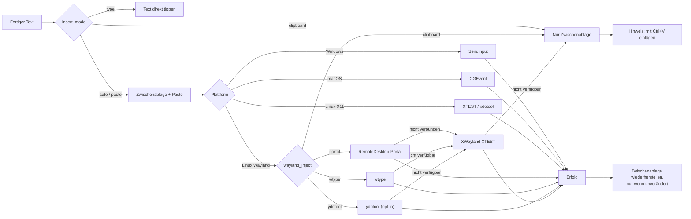
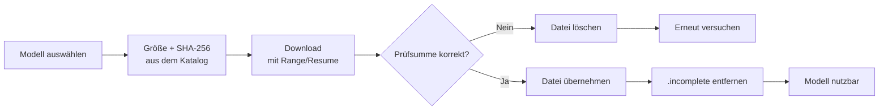
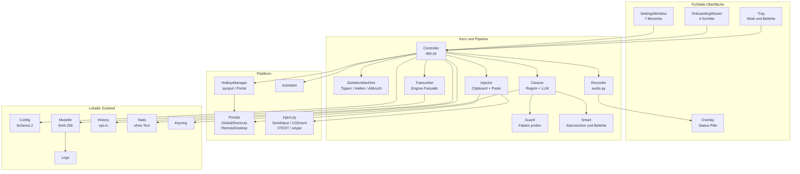
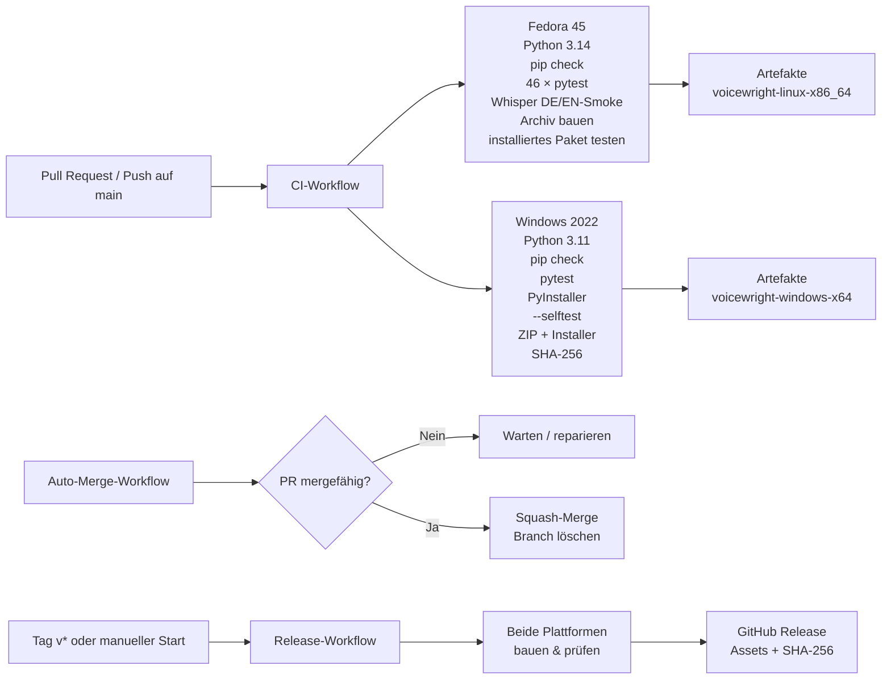
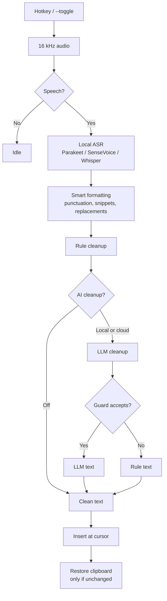

<p align="center">
  
</p>

<h1 align="center">Voicewright</h1>

<p align="center">
  <b>Diktieren, ohne dass dein Text das Gerät verlässt.</b><br>
  Lokale Spracherkennung, optionale KI-Bereinigung und direktes Einfügen in jede App.
</p>

<p align="center">
  <a href="https://github.com/mixxermannipro/Voicewright/actions/workflows/ci.yml"></a>
  <a href="https://github.com/mixxermannipro/Voicewright/actions/workflows/release.yml"></a>
  <a href="https://github.com/mixxermannipro/Voicewright/releases"></a>
  <a href="LICENSE"></a>
  <a href="pyproject.toml"></a>
  <a href="https://fedoraproject.org/"></a>
  <a href="https://www.microsoft.com/windows"></a>
  <a href="PRIVACY.md"></a>
</p>

<p align="center">
  <a href="https://github.com/mixxermannipro/Voicewright/releases">Releases</a> ·
  <a href="CHANGELOG.md">Changelog</a> ·
  <a href="docs/V2_STATUS.md">Status</a> ·
  <a href="PRIVACY.md">Datenschutz</a> ·
  <a href="SECURITY.md">Sicherheit</a> ·
  <a href="CONTRIBUTING.md">Mitmachen</a>
</p>

---

> **Kurz gesagt:** Voicewright startet die Aufnahme per globalem Tastenkürzel, transkribiert lokal mit Whisper, Parakeet oder SenseVoice, bereinigt den Text optional mit Regeln oder einem Sprachmodell und fügt ihn an der Cursorposition ein. Standardmäßig bleiben Audio und Text auf deinem Rechner. Kein Konto, keine Telemetrie, keine Cloud-Pflicht.

## Inhaltsverzeichnis

- [Warum Voicewright?](#warum-voicewright)
- [So sieht es aus](#so-sieht-es-aus)
- [Schnellstart](#schnellstart)
- [Bedienung](#bedienung)
- [Wie Voicewright funktioniert](#wie-voicewright-funktioniert)
- [Modelle](#modelle)
- [Architektur](#architektur)
- [Konfiguration](#konfiguration)
- [Kommandozeile](#kommandozeile)
- [Datenschutz & Sicherheit](#datenschutz--sicherheit)
- [Entwicklung / Development](#entwicklung--development)
- [Tests, CI & Release](#tests-ci--release)
- [Fehlerbehebung](#fehlerbehebung)
- [Bekannte Grenzen](#bekannte-grenzen)
- [Mitmachen](#mitmachen)
- [Lizenz & Danksagung](#lizenz--danksagung)
- [English](#english)

---

## Warum Voicewright?

Voicewright ist für Menschen gebaut, die schnell und viel schreiben – aber nicht wollen, dass jeder Satz durch einen Cloud-Dienst läuft.

- **Ein Kürzel, zwei Gesten.** Kurz tippen schaltet die Aufnahme um. Gedrückt halten spricht nur währenddessen. `Esc` verwirft die Aufnahme. Kein Moduswechsel, kein Menü.
- **Lokal zuerst.** Spracherkennung und regelbasierte Bereinigung brauchen kein Konto und keine Internetverbindung. Modelle werden einmalig heruntergeladen und danach offline verwendet.
- **Zwei Wege für sauberen Text.** Offline-Regeln entfernen Füllwörter, Stottern und Wiederholungen sofort. Optional übernimmt ein lokales Sprachmodell (Qwen3 über `llama.cpp`, Ollama oder LM Studio) oder ein Cloud-Anbieter mit deinem eigenen Schlüssel.
- **Sicherheitsnetz statt Blindflug.** Eine Schutzprüfung vergleicht die KI-Ausgabe mit dem Transkript: Zahlen, Links, E-Mails, Code, Wörterbuch-Einträge und Verneinungen dürfen nicht verschwinden. Im Zweifel bleibt der regelbereinigte Originaltext.
- **Direkt am Cursor.** Windows nutzt `SendInput`, macOS `CGEvent`, X11 `XTEST`/`xdotool`. Wayland nutzt nach ausdrücklicher Freigabe die offiziellen Portale `GlobalShortcuts` und `RemoteDesktop`; ohne Freigabe geht es über XTEST (XWayland) oder die Zwischenablage weiter. `wtype` und opt-in `ydotool` sind wählbar.
- **Kein Root, kein `uinput` standardmäßig.** Voicewright verlangt keine Systemrechte und keine rohen Eingabegeräte. `ydotool` ist ausdrücklich optional.
- **Deine Daten bleiben deine Daten.** Der Verlauf ist standardmäßig aus. Statistiken speichern nur Zahlen, nie Diktattext. API-Schlüssel liegen im System-Schlüsselbund. Cloud-Bereinigung ist opt-in.

## So sieht es aus

<p align="center">
  
</p>

<p align="center">
  <sub>Ausschnitt der Einstellungen, offscreen mit Qt gerendert (ohne Fenstermanager) – ohne Mikrofon, ohne echte Nutzerdaten.</sub>
</p>

Die Oberfläche hat sieben Bereiche: **Übersicht**, **Modelle**, **Bereinigung**, **Smartes**, **Ausgabe**, **Verlauf** und **Info**. Dazu kommen ein Tray-Menü, ein vierstufiger Einrichtungsassistent und eine schwebende Status-Pille für Aufnahme, Verarbeitung, Erfolg und Fehler.

## Schnellstart

### Fedora Linux (`x86_64`)

Fedora 45 liefert standardmäßig Python 3.15. Die gepinnte PySide6-Version unterstützt das noch nicht. Voicewright läuft mit **Python 3.11 bis 3.14**; unter Fedora 45 installierst du deshalb ausdrücklich `python3.14`. Auf älteren Releases funktionieren `python3.13`, `python3.12` oder `python3.11` genauso.

```bash
sudo dnf install python3.14 python3.14-devel gcc kernel-headers portaudio \
  xcb-util-cursor xcb-util-keysyms xcb-util-wm libxkbcommon-x11 \
  libglvnd-egl mesa-libGL
```

1. Lade das Linux-Paket und die passende SHA-256-Datei aus den [GitHub-Releases](https://github.com/mixxermannipro/Voicewright/releases).
2. Prüfe das Archiv und entpacke es in einen leeren Ordner. Ersetze die Versionsnummer, falls nötig.

   ```bash
   sha256sum -c Voicewright-2.0.0-linux-x86_64.tar.gz.sha256
   mkdir voicewright-install
   tar -xzf Voicewright-2.0.0-linux-x86_64.tar.gz -C voicewright-install
   bash voicewright-install/Voicewright/install.sh
   ```

3. Starte **Voicewright** im Anwendungsmenü. Der Einrichtungsassistent führt durch Modellwahl, Mikrofon-Test und Tastenkürzel. **Parakeet V3** läuft ohne zusätzliches Extra; alternativ stehen die Whisper-Modelle bereit, unter anderem **Whisper Small** und **Whisper Tiny**.

Der Installer sucht ein kompatibles Python 3.11–3.14, legt eine private virtuelle Umgebung unter `~/.local/opt/voicewright.XXXXXXXX` an, installiert das mitgelieferte Wheel samt Abhängigkeiten von PyPI und erzeugt:

| Datei / Ordner | Zweck |
| --- | --- |
| `~/.local/bin/voicewright` | Startbefehl |
| `~/.local/share/applications/voicewright.desktop` | Anwendungsmenü, Aktionen für `--toggle` und `--transform` |
| `~/.local/share/icons/hicolor/512x512/apps/voicewright.png` | Icon |
| `~/.local/opt/voicewright.*` | Private Python-Umgebung |

> **XWayland:** Für X11-Anwendungen unter Wayland heißt das Fedora-Paket `xorg-x11-server-Xwayland`.

**Update:** Ein neuer Installer ersetzt die Verknüpfung in `~/.local/bin` und legt eine neue Umgebung an. Ältere Installationen bleiben unter `~/.local/opt/voicewright.*` liegen und können nach dem Beenden von Voicewright manuell gelöscht werden.

**Deinstallieren:** Entferne `~/.local/bin/voicewright`, `~/.local/share/applications/voicewright.desktop`, das Icon und den Ordner unter `~/.local/opt`.

### Windows (`x64`)

Lade aus den [GitHub-Releases](https://github.com/mixxermannipro/Voicewright/releases) entweder das portable ZIP oder den Installer:

- **Portable:** `Voicewright-2.0.0-windows-x64.zip` entpacken und `Voicewright.exe` starten.
- **Installer:** `Voicewright-2.0.0-windows-x64-setup.exe` ausführen. Der Installer installiert pro Benutzer unter `%LOCALAPPDATA%\Programs\Voicewright`, ohne Administratorrechte.

Prüfe vor dem Start die SHA-256-Datei:

```powershell
Get-FileHash .\Voicewright-2.0.0-windows-x64.zip -Algorithm SHA256
Get-Content .\Voicewright-2.0.0-windows-x64.zip.sha256
```

Die Pakete sind derzeit **nicht signiert**. Windows SmartScreen kann deshalb warnen. Vergleiche in diesem Fall die Prüfsumme mit der Datei aus dem Release.

### macOS (Quellcode)

macOS ist ein unterstützter Quellcodepfad, aber **kein paketierter Release**. Du brauchst Python 3.11–3.14, PortAudio und die macOS-Zugriffsrechte:

```bash
brew install portaudio
python3.12 -m venv .venv
source .venv/bin/activate
python -m pip install -e .
python -m voicewright
```

Erlaube Voicewright unter **Systemeinstellungen → Datenschutz & Sicherheit** den Zugriff auf das **Mikrofon** und unter **Bedienungshilfen** die Tastatureingabe. Ohne die Bedienungshilfen-Freigabe verwirft macOS simulierte Tastendrücke stillschweigend. Das Einfügen läuft über `CGEvent`; ein DMG, eine Signierung und eine Notarisierung gibt es noch nicht.

### Aus dem Quellcode

```bash
git clone https://github.com/mixxermannipro/Voicewright.git
cd Voicewright
python3.14 -m venv .venv
source .venv/bin/activate
python -m pip install --upgrade pip
python -m pip install -r requirements-dev.txt
python -m pip install -e .

python -m pytest -q
python -m voicewright
```

Unter Fedora benötigst du die Systempakete aus dem Linux-Abschnitt. Unter Windows geht es analog mit `py -3.11 -m venv .venv`, `.venv\Scripts\activate` und `python -m voicewright`.

### Erster Start

- Ohne heruntergeladenes Sprachmodell öffnet sich der **vierstufige Assistent**: Willkommen → Modell → Mikrofon → Tastenkürzel und Einfügen.
- Nichts wird ohne deinen Klick heruntergeladen. Der Assistent zeigt Größe, Lizenz und Hinweis jedes Modells; das empfohlene Modell ist vorausgewählt.
- **Parakeet V3** ist die Standardempfehlung, wenn `sherpa-onnx` verfügbar ist. Ohne `sherpa-onnx` wählt Voicewright automatisch ein lauffähiges Whisper-Modell.
- Unter Wayland kann das System für globale Kürzel und Tastatureingaben eine Freigabe anzeigen. Lehnst du ab, bleibt Voicewright bedienbar und fällt auf XTEST über XWayland oder die Zwischenablage zurück.
- Der Assistent lässt sich jederzeit über **Einstellungen → Einrichtungsassistent** oder das Tray-Menü erneut öffnen.

## Bedienung

### Ein Kürzel, zwei Gesten



Im **Hybrid-Modus** startet jeder Druck sofort die Aufnahme. Ein Loslassen vor 350 ms gilt als Tippen: Die Aufnahme läuft weiter, bis du erneut drückst. Ein längeres Halten beendet die Aufnahme beim Loslassen. `Esc` verwirft sie.

Alternativ gibt es die Modi **Umschalten** (jeder Druck startet oder stoppt) und **Halten** (Aufnahme nur während des Gedrückthaltens; sehr kurze Tipper unter 250 ms werden verworfen). Der Modus lässt sich im Tray-Menü und in den Einstellungen wechseln.

### Tastenkürzel

| Aktion | Standard | Änderbar über |
| --- | --- | --- |
| Diktat starten / stoppen | `Ctrl + Shift + Leertaste` | Einstellungen → Übersicht → Diktier-Tastenkürzel |
| Aufnahme verwerfen | `Esc` | `cancel_with_escape` |
| Auswahl umschreiben | `Ctrl + Alt + Leertaste` | Einstellungen → Übersicht → Auswahl umschreiben |
| Einstellungen öffnen | Tray-Symbol oder `voicewright --show` | – |
| Diktat per System-Kurzbefehl | `voicewright --toggle` | GNOME, KDE oder andere Desktop-Umgebung |

Beide globalen Kürzel teilen sich einen Listener bzw. eine Portal-Sitzung. Überschneiden sie sich (gleich, Teilmenge oder Obermenge), wird das zweite Kürzel deaktiviert, weil sonst ein Kürzel das andere mit auslösen würde. Die Oberfläche weist darauf hin.

### Wayland

Voicewright nutzt die offiziellen XDG-Desktop-Portale:

- **`GlobalShortcuts`** liefert Tastendruck und Loslassen. Damit funktionieren Tippen und Halten auch auf Wayland.
- **`RemoteDesktop`** fügt `Ctrl+V` über den Compositor ein – nach ausdrücklicher Freigabe. Kein Root, kein `uinput`, keine rohen Eingabegeräte.

Die **Tastatureingabe-Freigabe** (`RemoteDesktop`) wird mit `persist_mode=2` und einem `restore_token` gespeichert. Solange sie gültig ist, stellt Voicewright die Sitzung beim nächsten Start ohne neuen Dialog wieder her. Nach einem Widerruf verwirft Voicewright den Token und fällt sauber zurück:

1. `RemoteDesktop`-Portal, falls freigegeben
2. XTEST über XWayland, falls verfügbar
3. Zwischenablage als letztes Sicherheitsnetz

`wtype` und das ausdrücklich opt-in geschaltete `ydotool` sind eigene Optionen in **Einstellungen → Ausgabe → Wayland-Einfügen**. Mit `wayland_inject = "auto"` in der Konfigurationsdatei probiert Voicewright zusätzlich `wtype` und `ydotool` vor XWayland.

Alternativ kannst du in GNOME oder KDE einen System-Kurzbefehl für `~/.local/bin/voicewright --toggle` anlegen und `wayland_hotkey` auf `desktop` stellen.

### Auswahl umschreiben

`Ctrl + Alt + Leertaste` oder `voicewright --transform` liest die aktuelle Auswahl, bereinigt sie und fügt sie wieder ein. Voicewright kopiert nur dann, wenn sich die Zwischenablage tatsächlich geändert hat, und legt den vorherigen Inhalt zurück, bevor der neue Text eingefügt wird. So geht keine frühere Kopie verloren.

### Tray und Status-Pille

Das Tray-Menü bietet Start/Stop, die drei Aufnahmemodi, den Einrichtungsassistenten, die Einstellungen und Beenden. Die schwebende Pille zeigt **Aufnahme**, **Verarbeitung**, **Erfolg** oder **Fehler**, ohne den Fokus zu stehlen. Position (oben/unten), Bewegung und Sichtbarkeit sind einstellbar.

## Wie Voicewright funktioniert

### Die Pipeline



### Vom Tastendruck bis zum Text



### Bereinigungsstufen

| Stufe | Was passiert | Lokal? | Abschaltbar? |
| --- | --- | --- | --- |
| 0 | Gesprochene Satzzeichen, Zeilen- und Absatzbefehle, Strukturwünsche | Ja | `spoken_punctuation`, `structure_mode` |
| 1 | Regeln: Füllwörter, Stottern, Wiederholungen, Selbstkorrekturen, Satzzeichen, Großschreibung | Ja | `cleanup_enabled` |
| 2 | Textbausteine und Wortersetzungen | Ja | `snippets`, `replacements` |
| 3 | Optionales Sprachmodell: lokal über `llama.cpp`, Ollama oder LM Studio; Cloud nur mit eigenem Schlüssel | Optional | `cleanup_provider` |
| 4 | Schutzprüfung nach jeder Modell-Antwort: Faktenverlust, Protokollreste, leere oder aufgeblähte Antworten | Ja | läuft automatisch |
| 5 | Fallback auf den regelbereinigten Text, wenn Stufe 3 oder 4 scheitert | Ja | automatisch |

**Gesprochene Satzzeichen** verstehen zum Beispiel `Komma`, `Punkt`, `Fragezeichen`, `Ausrufezeichen`, `Doppelpunkt`, `Semikolon`, `Gedankenstrich`, `Klammer auf`, `Klammer zu`, `Anführungszeichen auf`, `Anführungszeichen zu`, `neue Zeile` und `neuer Absatz` – auf Deutsch und Englisch. Zwischen `Literalmodus an` und `Literalmodus aus` bleibt alles unverändert, damit du über Wörter wie „Komma“ sprechen kannst.

**Strukturwünsche** wie „als Stichpunkte“, „als E-Mail“ oder „als Notizen“ formen den Text lokal um. **Umformulierungsbefehle** wie „kürzer“, „länger“, „formeller“, „lockerer“, „nur Grammatik“ oder „übersetze nach Englisch“ werden erkannt und an das optionale Sprachmodell weitergegeben. Sie lösen keine Systemaktionen aus.

### Die Schutzprüfung

Die Schutzprüfung kann keine semantische Gleichheit beweisen. Sie fängt aber die Fehler ab, die bei kleinen lokalen Modellen tatsächlich vorkommen:

- Protokollreste wie `<|im_start|>`, `<|endoftext|>` oder Code-Fences
- Assistenten-Floskeln wie „Hier ist der korrigierte Text:“
- leere Antworten, extreme Kürzungen im strikten Modus oder plötzliches Aufblähen
- verschwundene Zahlen, Datumsangaben, URLs, E-Mail-Adressen oder Code
- fehlende Wörterbuch-Einträge
- verlorene Verneinungen im strikten Modus

Bei einem Fehlschlag bekommt Voicewright den regelbereinigten Text zurück. Lieber ein etwas rauerer Originaltext als eine erfundene Aussage.

### Einfügen: die Fallback-Kette



### Warum das Sicherheitsnetz wichtig ist

Die Zwischenablage wird gespeichert, für das Einfügen verwendet und anschließend nur dann zurückgesetzt, wenn sie noch den eingefügten Text enthält. Hast du in der Zwischenzeit etwas Neues kopiert, bleibt deine neue Kopie unangetastet. Schnell aufeinanderfolgende Diktate und „Auswahl umschreiben“ verlieren den ursprünglichen Inhalt nicht.

## Modelle

Alle Modellgewichte werden bei Bedarf von Hugging Face geladen. Jede Datei hat eine feste Größe und SHA-256-Prüfsumme. Stimmt etwas nicht, wird die Datei gelöscht und **nicht** verwendet. Ein `.incomplete`-Marker verhindert, dass ein halber Download als fertig gilt.



### Spracherkennung

| Modell | Engine | Größe | Sprachen | Lizenz | Empfehlung |
| --- | --- | ---: | --- | --- | --- |
| **Parakeet TDT 0.6B v3** (int8) | `sherpa-onnx` | 675 MB | 25 europäische Sprachen | CC-BY-4.0 | **Standard**, sehr schnell auf CPU |
| SenseVoice Small (int8) | `sherpa-onnx` | 229 MB | Chinesisch, Englisch, Japanisch, Koreanisch, Kantonesisch | Apache-2.0 | Klein und schnell für asiatische Sprachen |
| Whisper Tiny | `faster-whisper` | 75 MB | 99 | MIT | Sehr schnell, geringe Genauigkeit, gut zum Testen |
| Whisper Base | `faster-whisper` | 145 MB | 99 | MIT | Schnell, brauchbar für klare Sprache |
| Whisper Small | `faster-whisper` | 485 MB | 99 | MIT | **CPU-Empfehlung** ohne GPU |
| Whisper Medium | `faster-whisper` | 1,53 GB | 99 | MIT | Hohe Genauigkeit, langsam auf CPU |
| Whisper Large v3 Turbo | `faster-whisper` | 1,62 GB | 99 | MIT | **GPU-Empfehlung**, nahe Large-v3-Qualität |
| Whisper Large v3 | `faster-whisper` | 3,09 GB | 99 | MIT | Maximale Genauigkeit, braucht starke Hardware |

Die Empfehlung lautet: **Parakeet V3**, wenn `sherpa-onnx` verfügbar ist; sonst **Whisper Small**, mit erkanntem CUDA-Gerät **Whisper Large v3 Turbo**. Beim Start prüft Voicewright, ob das gewählte Modell zur installierten Engine passt. Fehlt `sherpa-onnx`, wechselt die App auf ein heruntergeladenes, lauffähiges Whisper-Modell oder auf die Empfehlung. Ist noch kein Modell vorhanden, führt der Assistent zur Auswahl; ohne Modell startet kein Diktat.

### Lokale Bereinigung

| Modell | Datei | Größe | Lizenz | Hinweis |
| --- | --- | ---: | --- | --- |
| **Qwen3 0.6B (Q4_K_M)** | `Qwen3-0.6B-Q4_K_M.gguf` | 397 MB | Apache-2.0 | Standard, schnell genug für flüssiges Diktieren |
| Qwen3 1.7B (Q4_K_M) | `Qwen3-1.7B-Q4_K_M.gguf` | 1,11 GB | Apache-2.0 | Besser bei langen Sätzen und Umformulierungen |
| Qwen3 0.6B (Q8_0) | `Qwen3-0.6B-Q8_0.gguf` | 639 MB | Apache-2.0 | Etwas höhere Wiedergabetreue, etwas langsamer |

Die lokale Engine ist `llama.cpp` in Version `b12728`. Die passende Laufzeit wird – wie die Modelle – erst nach deinem Klick heruntergeladen und mit fester Größe und SHA-256 geprüft. Sie läuft als privater Server auf `127.0.0.1` mit einem zufälligen freien Port und wird beim Beenden von Voicewright gestoppt. Es gibt keine Web-Oberfläche und keinen Zugriff von außen.

### Cloud-Bereinigung (optional)

| Anbieter | Schlüssel nötig? | Läuft wo? | Standardmodell |
| --- | --- | --- | --- |
| **Regeln** | Nein | Lokal | – |
| **Lokales Modell** | Nein | `llama.cpp` auf deinem Rechner | Qwen3 0.6B |
| Ollama | Nein | `http://localhost:11434/v1` | `llama3.2` |
| LM Studio | Nein | `http://localhost:1234/v1` | frei wählbar |
| Google AI Studio (Gemini) | Ja | Cloud | `gemini-2.5-flash` |
| OpenAI | Ja | Cloud | `gpt-4.1-mini` |
| Anthropic (Claude) | Ja | Cloud | `claude-3-5-haiku-latest` |
| Groq | Ja | Cloud | `llama-3.3-70b-versatile` |
| OpenRouter | Ja | Cloud | `google/gemini-2.5-flash` |
| Mistral AI | Ja | Cloud | `mistral-small-latest` |
| Eigener OpenAI-kompatibler Server | Nein* | Dein Server | frei wählbar |

\* Ein eigener Server kann einen Schlüssel verlangen; Voicewright sendet ihn nur, wenn du einen hinterlegst.

Cloud-Anbieter erhalten den erkannten Text **nur**, wenn du sie ausdrücklich als Bereinigungsanbieter auswählst. Die Standardeinstellung ist `rules`. API-Schlüssel werden über das System-Schlüsselbund gelesen und geschrieben; ohne funktionierendes Schlüsselbund gibt es keinen Klartext-Fallback.

## Architektur



### Module

| Modul | Aufgabe |
| --- | --- |
| `main.py` | Argumente, Logging, Single-Instance-IPC, Qt-Start, `--selftest` |
| `app.py` | Controller: Hotkeys, Aufnahme, Pipeline, Tray, Overlay, IPC |
| `dictation.py` | Reine Zustandsmaschine für Tippen, Halten und Abbruch; mit injizierbarer Uhr testbar |
| `audio.py` | Mikrofonaufnahme (16 kHz mono float32), Gerätewahl, Stille-Trimmen, Feedback-Töne |
| `transcriber.py` | Wählt die Engine anhand des Modells und lädt/entlädt Modelle |
| `engines.py` | `sherpa-onnx` (Parakeet/SenseVoice) und `faster-whisper` (Whisper) |
| `models.py` | Modellkatalog, Größen/SHA-256, Resume-Download, `llama.cpp`-Runtime |
| `cleanup.py` | Regel- und LLM-Bereinigung, Provider, Prompt, Fallback |
| `guard.py` | Schutzprüfung für Zahlen, Links, Code, Wörterbuch und Verneinungen |
| `smart.py` | Gesprochene Satzzeichen, Struktur, Befehle, Snippets, Ersetzungen |
| `injector.py` | Zwischenablage speichern/wiederherstellen, Paste, Portal-Sitzung |
| `inject.py` | Plattformspezifische Tastatureingabe mit Fallback-Kette |
| `hotkey.py` | Tastenkürzel parsen, normalisieren, Kombinationen erkennen, pynput/Portal |
| `portals.py` | D-Bus-Portale `GlobalShortcuts` und `RemoteDesktop` über `jeepney` |
| `config.py` | JSON-Konfiguration, Defaults, Migration v1 → v2, atomisches Speichern |
| `paths.py` | XDG-/Windows-/macOS-Pfade, Ressourcen, Sitzungstyp |
| `keystore.py` | API-Schlüssel im System-Schlüsselbund, Umgebungsvariablen-Override |
| `history.py` | Lokaler Diktatverlauf, standardmäßig aus |
| `stats.py` | Lokale Statistik ohne Textspeicherung |
| `runtime.py` | Privater `llama-server`-Prozess, Health-Check, sauberes Beenden |
| `autostart.py` | Autostart über XDG, Windows-Registry oder LaunchAgent |
| `i18n.py` | Deutsche und englische Oberflächentexte |
| `ui/` | Einstellungen, Assistent, Overlay, Theme, Widgets, Hintergrundaufgaben |

### Threads und Verantwortlichkeiten

- Der **Qt-Hauptthread** besitzt Oberfläche, Tray, Zwischenablage und Einfügen.
- Der **Hotkey-Listener** läuft in einem eigenen Thread und meldet Ereignisse über Qt-Signale an den Hauptthread.
- Der **Audio-Callback** liefert Blöcke und Pegel; die Aufnahme landet im Speicher, nicht auf der Platte.
- **Blockierende Arbeit** (Transkription, Bereinigung, Modell-Download, Portal-Aufbau) läuft in einem Hintergrund-Thread. Ergebnisse werden über Signale zurückgegeben, damit die Oberfläche nicht einfriert.
- Der **lokale `llama-server`** ist ein separater Kindprozess mit eigenem Log und wird beim Beenden beendet.

## Konfiguration

Die Konfiguration liegt als JSON vor und hat **Schema-Version 2**. Beim Laden werden fehlende Defaults ergänzt, unbekannte Schlüssel bleiben erhalten, und v1-Dateien werden ohne Datenverlust migriert (inklusive alter Whisper-Modellnamen). Ist die Datei unlesbar, legt Voicewright sie als `.broken.json` beiseite und startet mit Defaults. Gespeichert wird atomar über eine temporäre Datei.

### Speicherorte

| Plattform | Konfiguration | Daten, Modelle, Logs |
| --- | --- | --- |
| Linux | `$XDG_CONFIG_HOME/voicewright/config.json` oder `~/.config/voicewright/config.json` | `$XDG_DATA_HOME/voicewright/` oder `~/.local/share/voicewright/` |
| Windows | `%APPDATA%\Voicewright\config.json` | `%LOCALAPPDATA%\Voicewright\` |
| macOS | `~/Library/Application Support/Voicewright/` | `~/Library/Application Support/Voicewright/` |

Unter den Daten liegen:

```text
<Datenordner>/voicewright/
├── history.json             # nur bei aktiviertem Verlauf
├── stats.json               # Zahlen, kein Text
├── logs/
│   ├── voicewright.log      # rotierend, max. 1 MB × 3
│   └── llama-server.log
├── models/
│   ├── parakeet-v3/
│   ├── whisper-small/
│   └── qwen3-0.6b-q4/
└── runtime/
    └── llama-b12728/
```

Die `config.json` liegt im Konfigurationsordner aus der Tabelle oben, nicht im Datenordner. Unter Windows liegen Konfiguration (`%APPDATA%`, Roaming) und Daten (`%LOCALAPPDATA%`) getrennt; unter macOS teilen sich beide denselben `Application Support`-Ordner.

### Wichtige Schlüssel

<details>
<summary><b>Hotkey, Audio und Aufnahme</b></summary>

| Schlüssel | Default | Bedeutung |
| --- | --- | --- |
| `hotkey` | `ctrl+shift+space` | Globales Diktat-Kürzel |
| `hotkey_mode` | `hybrid` | `hybrid`, `toggle` oder `hold` |
| `tap_threshold_ms` | `350` | Grenze zwischen Tippen und Halten (150–900 ms) |
| `min_hold_ms` | `250` | Kürzere Tipper werden im Halten-Modus verworfen |
| `transform_hotkey` | `ctrl+alt+space` | Kürzel für „Auswahl umschreiben“ |
| `cancel_with_escape` | `true` | `Esc` verwirft die Aufnahme |
| `hotkey_backend` | `auto` | `auto`, `pynput`, `portal` oder `none` |
| `wayland_hotkey` | `portal` | `portal` oder `desktop` (System-Kurzbefehl) |
| `input_device` | `null` | `null` = Systemstandard, sonst Gerätename |
| `sounds_enabled` | `true` | Kurze Start-/Stopp-/Fehlertöne |
| `max_recording_seconds` | `600` | Maximale Aufnahmedauer |
| `silence_trim` | `true` | Stille am Anfang und Ende abschneiden |

</details>

<details>
<summary><b>Spracherkennung</b></summary>

| Schlüssel | Default | Bedeutung |
| --- | --- | --- |
| `speech_model` | `parakeet-v3` | Modell-ID aus dem Katalog |
| `speech_engine` | `auto` | `auto`, `whisper` oder `sherpa` |
| `whisper_model` | `small` | Legacy-Alias, wird mit `speech_model` synchron gehalten |
| `whisper_device` | `auto` | `auto`, `cpu` oder `cuda` |
| `whisper_compute_type` | `auto` | `auto`, `int8`, `int8_float16`, `float16`, `float32` |
| `language` | `auto` | `auto` oder ISO-Sprachcode |
| `whisper_task` | `transcribe` | `transcribe` oder `translate` (offline nach Englisch) |
| `initial_prompt` | `""` | Vokabelhinweise für Whisper |
| `vad_filter` | `true` | Sprachaktivitätserkennung in Whisper |
| `beam_size` | `5` | Whisper-Beam-Suche |
| `keep_model_loaded` | `true` | Modell nach dem Diktat im Speicher halten |

</details>

<details>
<summary><b>Bereinigung und Schutzprüfung</b></summary>

| Schlüssel | Default | Bedeutung |
| --- | --- | --- |
| `cleanup_enabled` | `true` | Regelbereinigung aktiv |
| `cleanup_provider` | `rules` | `none`, `rules`, `local`, `gemini`, `openai`, `anthropic`, `groq`, `openrouter`, `mistral`, `ollama`, `lmstudio`, `custom` |
| `cleanup_style` | `clean` | `clean`, `minimal`, `formal`, `casual`, `notes`, `email` |
| `output_language` | `same` | `same` oder Zielsprache für Übersetzung |
| `custom_instructions` | `""` | Zusätzliche Wünsche an das Sprachmodell |
| `custom_dictionary` | `[]` | Wörter, deren Schreibweise erhalten bleiben muss |
| `cleanup_timeout` | `30` | Sekunden bis zum Abbruch |
| `local_model` | `qwen3-0.6b-q4` | Modell-ID aus dem Bereinigungskatalog |
| `llm_runtime` | `auto` | `auto`, `bundled`, `ollama`, `lmstudio`, `off` |
| `llm_model` | `""` | Modellname für Ollama oder LM Studio |
| `llm_threads` | `0` | `0` = automatisch |
| `llm_context` | `2048` | Kontextfenster |

</details>

<details>
<summary><b>Smart-Funktionen</b></summary>

| Schlüssel | Default | Bedeutung |
| --- | --- | --- |
| `smart_formatting` | `true` | Gesprochene Satzzeichen und Struktur |
| `spoken_punctuation` | `true` | Wörter wie „Komma“ in Zeichen umwandeln |
| `structure_mode` | `auto` | `auto` oder `off`; die Werte `list`, `email`, `notes` sind vorgesehen, erzwingen aber noch keine Struktur |
| `command_mode` | `true` | Befehle wie „kürzer“ oder „formeller“ erkennen |
| `snippets` | `[]` | `[{"name": "...", "text": "..."}]` |
| `replacements` | `{}` | `{"gehört": "geschrieben"}` |
| `emoji_enabled` | `false` | Emoji-Befehl ausdrücklich erlauben |

</details>

<details>
<summary><b>Ausgabe, Oberfläche und Datenschutz</b></summary>

| Schlüssel | Default | Bedeutung |
| --- | --- | --- |
| `insert_mode` | `auto` | `auto`, `paste`, `type`, `clipboard` |
| `paste_shortcut` | `auto` | `auto`, `ctrl_v`, `ctrl_shift_v` (Terminals) |
| `restore_clipboard` | `true` | Vorherige Zwischenablage zurücklegen |
| `clipboard_restore_ms` | `400` | Wartezeit vor der Wiederherstellung |
| `add_trailing_space` | `true` | Leerzeichen nach dem Diktat |
| `wayland_inject` | `portal` | `portal`, `wtype`, `ydotool`, `clipboard`; `auto` probiert die Kette |
| `ydotool_enabled` | `false` | `ydotool` ausdrücklich erlauben |
| `ui_language` | `auto` | `auto`, `de` oder `en` |
| `theme` | `system` | `system`, `light`, `dark` |
| `reduce_motion` | `false` | Animationen reduzieren |
| `show_overlay` | `true` | Schwebende Status-Pille |
| `overlay_position` | `bottom` | `bottom` oder `top` |
| `start_minimized` | `true` | Im Tray starten |
| `history_enabled` | `false` | Lokalen Verlauf speichern |
| `history_limit` | `200` | Maximale Verlaufsgröße |
| `stats_enabled` | `true` | Lokale Statistik ohne Text |
| `wayland_consent` | `false` | Freigabe für Tastatureingabe |
| `wayland_restore_token` | `""` | Vom Portal ausgestellter Wiederherstellungs-Token |

</details>

Die vollständige Liste steht in [`src/voicewright/config.py`](src/voicewright/config.py). Neue oder unbekannte Schlüssel werden beim Speichern nicht verworfen.

### Umgebungsvariablen

| Variable | Wirkung |
| --- | --- |
| `VOICEWRIGHT_CONFIG_DIR` | Überschreibt den Konfigurationsordner |
| `VOICEWRIGHT_DATA_DIR` | Überschreibt den Datenordner (Modelle, Logs, Verlauf) |
| `HF_ENDPOINT` | Anderer Hugging-Face-Endpunkt, Standard `https://huggingface.co` |
| `HF_TOKEN` | Optionaler Token für Hugging-Face-Downloads |
| `VOICEWRIGHT_<PROVIDER>_API_KEY` | API-Schlüssel per Umgebung, z. B. `VOICEWRIGHT_OPENAI_API_KEY` |
| `VOICEWRIGHT_PYTHON` | Python-Interpreter für den Linux-Installer |
| `QT_QPA_PLATFORM` | Erzwingt das Qt-Plattform-Plugin; eine explizite Vorgabe gewinnt immer |

## Kommandozeile

```text
voicewright [--toggle | --start | --stop | --cancel | --transform | --show | --quit]
            [--minimized] [--debug] [--version]
```

| Befehl | Wirkung |
| --- | --- |
| `--toggle` | Diktat starten oder stoppen |
| `--start` | Aufnahme starten, wenn die App im Leerlauf ist |
| `--stop` | Laufende Aufnahme beenden und verarbeiten |
| `--cancel` | Laufende Aufnahme verwerfen |
| `--transform` | Aktuelle Auswahl umschreiben |
| `--show` | Einstellungen öffnen |
| `--quit` | Voicewright beenden |
| `--minimized` | Im Tray starten, ohne das Fenster zu zeigen |
| `--debug` | Ausführliches Logging |
| `--version` | Version ausgeben |
| `--selftest` | Versteckter Paket-Selbsttest für die CI (kein Modell, kein Mikrofon) |

Läuft bereits eine Instanz, schickt Voicewright den Befehl über einen lokalen Socket (`QLocalSocket`) an sie und beendet sich sofort. `--stop`, `--cancel` und `--quit` geben einen Fehlercode zurück, wenn keine Instanz läuft. Das macht `voicewright --toggle` ideal für einen Desktop-Kurzbefehl.

## Datenschutz & Sicherheit

### Was das Gerät verlässt – und wann

| Verbindung | Wann | Was wird übertragen? |
| --- | --- | --- |
| Hugging Face | Nur beim Download eines Modells | Modell-ID und Dateianfrage; kein Diktattext |
| GitHub Releases | Nur beim Download der `llama.cpp`-Laufzeit | Versionsanfrage; kein Diktattext |
| Cloud-Anbieter | Nur wenn du ihn als Bereinigungsanbieter auswählst | Der erkannte Text |
| Ollama / LM Studio / eigener Server | Nur wenn ausgewählt | Der erkannte Text an deinen lokalen oder eigenen Server |
| System-Schlüsselbund | Beim Lesen/Schreiben eines API-Schlüssels | Kein Diktattext |

Es gibt **keine Telemetrie**, kein Konto und keine Analyse-SDKs. Der Verlauf ist standardmäßig aus; Statistiken speichern nur Anzahl, Wörter, Zeichen, Audiodauer und Tageswerte – **keinen Text**.

### Schutzentscheidungen

- **Modelle:** feste Größe und SHA-256 pro Datei; fehlerhafte Downloads werden gelöscht.
- **Laufzeit:** `llama.cpp` wird erst nach einem Klick geladen, mit SHA-256 geprüft und als privater Prozess auf `127.0.0.1` gestartet.
- **Schlüssel:** API-Schlüssel liegen im System-Schlüsselbund. Ein Umgebungsvariablen-Override ist für fortgeschrittene Setups möglich. Ohne Schlüsselbund gibt es keinen Klartext-Fallback.
- **Cloud:** standardmäßig aus. Der Text geht nur an den Anbieter, den du auswählst.
- **Zwischenablage:** wird nur wiederhergestellt, wenn sie noch den eingefügten Text enthält.
- **Wayland:** offizielle Portale, ausdrückliche Freigabe, kein Root, kein `uinput` standardmäßig.
- **`ydotool`:** ausdrücklich opt-in, weil es rohe Eingabegeräte benötigt.
- **Pakete:** die Linux- und Windows-Pakete sind derzeit **unsigniert**. Prüfe die SHA-256-Datei aus dem Release.

### Wenn du eine Sicherheitslücke findest

Bitte **nicht** öffentlich mit Exploit-Details posten. Nutze auf GitHub **Security → Report a vulnerability** oder bitte in einem Issue ohne technische Details um einen vertraulichen Kontaktweg. Weitere Hinweise stehen in [SECURITY.md](SECURITY.md).

## Entwicklung / Development

### Voraussetzungen

- Python **3.11–3.14**
- Git
- Fedora: die Systempakete aus dem Schnellstart
- Windows: Python 3.11 x64 und optional Inno Setup 6 für den Installer
- Tests: `pytest`, `PySide6`, `faster-whisper`, `sherpa-onnx`, `sounddevice`
- Linux-Smoke-Tests: `Xvfb`, `xauth`, `xclip`, `espeak-ng`, `pulseaudio`, `pulseaudio-utils`

### Einrichten

```bash
python3.14 -m venv .venv
source .venv/bin/activate
python -m pip install --upgrade pip
python -m pip install -r requirements-dev.txt
python -m pip install -e ".[x11]"
```

`.[x11]` installiert `python-xlib` für XTEST. Ohne dieses Extra fällt Voicewright unter X11 auf `xdotool` zurück.

### Prüfen

```bash
python -m pytest -q
python -m pip check
PYTHONPATH=src xvfb-run -a python scripts/smoke-whisper.py /tmp/voicewright-test-model
bash scripts/build-linux.sh
xvfb-run -a bash scripts/smoke-linux.sh release/Voicewright-*-linux-x86_64.tar.gz /tmp/voicewright-test-model
```

Der Whisper-Smoke-Test lädt **Whisper Tiny** mit fester Revision und SHA-256, erzeugt mit `espeak-ng` synthetische deutsche und englische Sprache und prüft die Erkennung sowie das Einfügen in die Zwischenablage. Der installierte Paket-Test läuft in Xvfb mit einem virtuellen PulseAudio-Gerät und testet die echte App aus dem Archiv.

### Builds

**Linux:**

```bash
bash scripts/build-linux.sh
```

Erzeugt `release/Voicewright-<version>-linux-x86_64.tar.gz` und die passende `.sha256`-Datei. Voraussetzung ist `x86_64`, ein kompatibles Python und `pip wheel`.

**Windows:**

```bat
scripts\build.bat
```

Erzeugt `dist\Voicewright\Voicewright.exe`, ein portables ZIP, – falls Inno Setup 6 installiert ist – einen Installer und SHA-256-Dateien. Der Build führt vorher `pip check` und die Tests aus.

**PyInstaller direkt:**

```bash
python -m PyInstaller --noconfirm --clean voicewright.spec
```

### Warum diese Pins?

- **PySide6-Essentials 6.11.2** ist exakt gepinnt, damit alle Plattformen dieselbe Qt-Version verwenden.
- **`av >= 16, < 19`**: PyAV 19 entfernt `metadata_errors`, das `faster-whisper` 1.2.x noch übergibt.
- **`numpy >= 1.24, < 2.5`**: numpy 2.5 verlangt Python ≥ 3.12, Voicewright unterstützt aber 3.11.
- **`sherpa-onnx >= 2.0, < 3.0`** ist Standardabhängigkeit, damit Parakeet und SenseVoice ohne Extra laufen.

### Projektstruktur

```text
Voicewright/
├── src/voicewright/
│   ├── main.py              # Einstieg, CLI, IPC
│   ├── app.py               # Controller & Pipeline
│   ├── dictation.py         # Hybrid-Zustandsmaschine
│   ├── audio.py             # Aufnahme & Töne
│   ├── engines.py           # sherpa-onnx & faster-whisper
│   ├── transcriber.py       # Engine-Auswahl
│   ├── models.py            # Katalog & Downloader
│   ├── cleanup.py           # Regeln, Provider, Prompt
│   ├── guard.py             # Schutzprüfung
│   ├── smart.py             # Satzzeichen, Befehle, Snippets
│   ├── injector.py          # Zwischenablage & Paste
│   ├── inject.py            # Plattform-Tastatureingabe
│   ├── hotkey.py            # Kürzel & Backends
│   ├── portals.py           # Wayland-D-Bus
│   ├── runtime.py           # llama.cpp-Prozess
│   ├── config.py            # Schema & Migration
│   ├── paths.py             # Speicherorte
│   ├── keystore.py          # Schlüsselbund
│   ├── history.py           # Verlauf
│   ├── stats.py             # Statistik
│   ├── autostart.py         # Autostart
│   ├── i18n.py              # Deutsch/Englisch
│   └── ui/                  # Fenster, Assistent, Overlay, Theme
├── tests/                   # 46 Tests
├── scripts/                 # Builds, Smoke-Tests, Launcher
├── packaging/               # Linux-Installer, Desktop-Datei, Inno Setup
├── docs/                    # Status, Screenshot, Release-Vorlage
├── .github/workflows/       # CI, Release, Auto-Merge
├── pyproject.toml
├── requirements.txt
└── voicewright.spec
```

## Tests, CI & Release

### Testübersicht

Der aktuelle Stand umfasst **46 automatisierte Tests**:

| Datei | Tests | Schwerpunkt |
| --- | ---: | --- |
| `tests/test_core.py` | 13 | Hotkey-Parsing, Combo-Erkennung, Regeln, Config, Audio, HTTP, Keyring, Wayland-Fallbacks |
| `tests/test_v2.py` | 10 | Hybrid-Gesten, Guard, Smart-Features, Migration, Modellkatalog, Injection-Reihenfolge, Portal-Helfer, Statistik, Headless-UI |
| `tests/test_production.py` | 23 | Lauffähiges Default-Modell, Onboarding/Restore-Token, Multi-Hotkey, Portal-D-Bus, Windows-Strukturen, UTF-16, Clipboard-Restore, Mikrofon-Tester, Qt-Plattform |

Alle Sprachtests verwenden **synthetisches Audio** (`espeak-ng`/WAV). Die Tests greifen nicht auf das Mikrofon oder den Desktop des Eigentümers zu.

### CI-Pipeline



### Was die CI wirklich prüft

**Linux-Job (`check`, Fedora-45-Container):**

- `python -m pip check`
- `python -m pytest -q` – 46 Tests
- `xvfb-run python scripts/smoke-whisper.py` – Whisper Tiny mit SHA-256, synthetisches Deutsch und Englisch
- `bash scripts/build-linux.sh` – Wheel, Archiv, Prüfsumme
- `runuser -u nobody -- xvfb-run bash scripts/smoke-linux.sh` – Installation und Diktat als normaler Benutzer, mit virtuellem PulseAudio und Xvfb

**Windows-Job (`windows-2022`):**

- `pip check` und `pytest` mit `QT_QPA_PLATFORM=offscreen`
- PyInstaller-Build der fensterlosen `Voicewright.exe`
- `Voicewright.exe --selftest` – echte `QApplication`, alle GUI-Module, kein Modell, kein Mikrofon
- Portables ZIP und Inno-Setup-Installer
- SHA-256 mit LF-Zeilenenden, damit `sha256sum -c` auch unter Linux funktioniert

**Auto-Merge:** `automerge.yml` aktiviert GitHub Auto-Merge für PRs des Repository-Eigentümers und für Dependabot-Updates vom Typ `minor`/`patch`. Major- und Security-Updates werden nicht automatisch gemergt.

**Release:** `release.yml` startet bei Tags `v*` oder manuell mit einem vorhandenen Tag. Beide Plattform-Jobs bauen und prüfen aus demselben Commit. Nur der Veröffentlichungs-Job hat Schreibrechte und lädt die Assets samt Prüfsummen in den GitHub-Release.

### Release-Artefakte

| Datei | Plattform | Inhalt |
| --- | --- | --- |
| `Voicewright-<version>-linux-x86_64.tar.gz` | Linux | Wheel, Installer, Desktop-Datei, Icon, Lizenz, README |
| `Voicewright-<version>-linux-x86_64.tar.gz.sha256` | Linux | Prüfsumme |
| `Voicewright-<version>-windows-x64.zip` | Windows | Portable `Voicewright.exe` und Laufzeitdateien |
| `Voicewright-<version>-windows-x64.zip.sha256` | Windows | Prüfsumme |
| `Voicewright-<version>-windows-x64-setup.exe` | Windows | Inno-Setup-Installer |
| `Voicewright-<version>-windows-x64-setup.exe.sha256` | Windows | Prüfsumme |

### Plattformabdeckung

| Plattform | Status | Automatisch geprüft | Ehrliche Grenze |
| --- | --- | --- | --- |
| **Fedora Linux x86_64** | Release-Ziel | Ja: Tests, Whisper-Smoke, Archiv, installiertes Paket in Xvfb + virtuellem PulseAudio | Kein echtes Mikrofon, keine echte Desktop-Sitzung, kein echter Wayland-Compositor in CI |
| **Windows x64** | Release-Ziel | Ja: Tests, PyInstaller, Selbsttest, ZIP, Installer, SHA-256 | Kein echter Einfügetest in fremde Anwendungen mit realer Tastatur in CI |
| **macOS** | Quellcode | Nein | Kein DMG, keine Signierung, keine Notarisierung, keine CI-Ausführung |
| **Linux ARM64** | Quellcode möglich | Nein | Kein Linux-ARM-Paket; die gebündelte `llama.cpp`-Laufzeit ist nur für Linux x86_64 hinterlegt |

## Fehlerbehebung

| Problem | Ursache | Lösung |
| --- | --- | --- |
| `Voicewright needs Python 3.11 to 3.14` | Fedora 45 nutzt standardmäßig Python 3.15 | `sudo dnf install python3.14 python3.14-devel` und den Installer erneut ausführen; alternativ `VOICEWRIGHT_PYTHON` setzen |
| „Kein Sprachmodell heruntergeladen“ | Erststart ohne Modell | Einstellungen → Modelle → empfohlenes Modell herunterladen |
| Kein globales Kürzel unter Wayland | Portal nicht verfügbar oder Freigabe abgelehnt | System-Kurzbefehl für `voicewright --toggle` anlegen oder Portal-Freigabe erneut erteilen |
| Einfügen unter Wayland landet nur in der Zwischenablage | `RemoteDesktop` nicht freigegeben, `wtype` fehlt | Portal-Freigabe in den Einstellungen erteilen, `wtype` installieren oder Text mit `Ctrl+V` einfügen |
| Kein Einfügen unter X11 | `python-xlib` und `xdotool` fehlen | `python -m pip install -e ".[x11]"` oder `sudo dnf install xdotool` |
| Mikrofon wird nicht erkannt | PortAudio/Gerät fehlt oder belegt | `portaudio` installieren, Gerät in den Einstellungen wählen, Mikrofon-Test starten |
| KI-Bereinigung meldet „Kein API-Schlüssel“ | Anbieter ausgewählt, aber kein Schlüssel hinterlegt | Schlüssel im System-Schlüsselbund speichern oder `VOICEWRIGHT_<PROVIDER>_API_KEY` setzen |
| Lokales Modell startet nicht | `llama-server` fehlt oder Modell nicht heruntergeladen | Laufzeit und Modell in den Einstellungen herunterladen; Log unter `logs/llama-server.log` prüfen |
| Zwischenablage wird nicht zurückgesetzt | Du hast während des Diktats etwas Neues kopiert | Das ist Absicht: Voicewright überschreibt deine neue Kopie nicht |
| App startet nicht nach Update | Alte Installation oder defekte Config | `~/.local/bin/voicewright --debug` starten; defekte Config wird als `.broken.json` gesichert |
| Windows-SmartScreen-Warnung | Paket ist nicht signiert | SHA-256 mit der Release-Datei vergleichen; „Weitere Informationen“ → „Trotzdem ausführen“ nur nach Prüfung |

**Logs:** `~/.local/share/voicewright/logs/voicewright.log` (Linux) bzw. `%LOCALAPPDATA%\Voicewright\logs\voicewright.log` (Windows). Mit `--debug` wird das Log ausführlicher.

## Bekannte Grenzen

Voicewright 2.0 ist ehrlich getestet – aber nicht auf jeder echten Hardware. Diese Grenzen sind bewusst dokumentiert:

- **Kein echtes Mikrofon und kein echter Desktop in CI.** Die Tests nutzen Xvfb, virtuelles PulseAudio und synthetische Sprache. Ein echter GNOME-/KDE-Wayland-Durchlauf mit Portal-Dialog, realem Fokus und fremden Anwendungen bleibt eine Desktop-Abnahme.
- **Wayland-Portale:** D-Bus-Aufbau, Token-Speicherung, Signal-Header und Fehlerpfade sind per Unit-Test abgedeckt. Der echte Freigabedialog auf GNOME/KDE wurde nicht automatisch durchgeklickt. Ohne Freigabe bleibt die Zwischenablage das Sicherheitsnetz.
- **macOS:** `CGEvent` ist implementiert, aber es gibt kein DMG, keine Signierung, keine Notarisierung und keine CI-Ausführung.
- **SenseVoice:** im Katalog mit Prüfsumme hinterlegt, aber nicht mit echtem asiatischem Audio getestet.
- **Schutzprüfung:** Sie erkennt Faktenverlust, Protokollreste und typische Kleinmodell-Fehler – sie kann keine subtile Bedeutungsänderung oder Halluzination beweisen.
- **Drei Schalter ohne volle Wirkung:** `guard_enabled` und `cleanup_fallback_rules` werden von der Oberfläche gespeichert, aber noch nicht ausgewertet; die Schutzprüfung und der Fallback auf den Regeltext laufen immer. Bei `structure_mode` wirkt derzeit nur `off`; die festen Modi `list`, `email` und `notes` sind noch nicht erzwungen.
- **Pakete:** Linux- und Windows-Pakete sind unsigniert. Es gibt keine authentifizierten automatischen Updates und keinen Rollback-Kanal.
- **Builds:** Es gibt kein bit-identisches Buildversprechen.
- **Linux ARM64:** kein fertiges Paket; die gebündelte `llama.cpp`-Laufzeit fehlt für diese Architektur.
- **Große Modelle:** Whisper Medium/Large brauchen viel RAM und auf CPU deutlich länger. Die Größen- und RAM-Angaben im Katalog sind Schätzungen, keine Garantien für jede Hardware.

## Mitmachen

Beiträge sind willkommen – besonders Tests, Plattformberichte und Dokumentation.

1. **Issue öffnen** oder einen bestehenden Bug beschreiben: Betriebssystem, Sitzungstyp (X11/Wayland), Version, Schritte, erwartetes und tatsächliches Verhalten.
2. **Branch anlegen:** `feat/kurz-name`, `fix/kurz-name`, `docs/kurz-name` oder `test/kurz-name`.
3. **Klein und prüfbar bleiben:** eine Änderung, ein Ziel, ein PR.
4. **Tests ausführen:** `python -m pytest -q` und, wenn betroffen, den Whisper-Smoke-Test und den installierten Paket-Test.
5. **PR öffnen** mit dem ausgefüllten [Pull-Request-Template](.github/PULL_REQUEST_TEMPLATE.md). Gib an, was du wirklich geprüft hast, und was nicht.
6. **Keine echten Geheimnisse, Mikrofonaufnahmen oder persönlichen Diktate** in Issues, Tests oder Commits. Nutze synthetische Audio- und Textdaten.

Der `check`-Workflow ist der zentrale Linux-Check. Der Windows-Job prüft zusätzlich den Build und die Paketierung. Bitte beschreibe in deinem PR ehrlich, welche Plattform du tatsächlich getestet hast.

## Lizenz & Danksagung

Voicewright ist **MIT-lizenziert**. Siehe [LICENSE](LICENSE).

Die Modellgewichte haben eigene Lizenzen:

| Komponente | Lizenz |
| --- | --- |
| Voicewright-Quellcode | MIT |
| Parakeet TDT 0.6B v3 | CC-BY-4.0 |
| SenseVoice Small | Apache-2.0 |
| Whisper-Modelle (faster-whisper) | MIT |
| Qwen3-Modelle | Apache-2.0 |
| `llama.cpp` / ggml | MIT |
| PySide6 / Qt | LGPL-3.0 (bzw. kommerzielle Qt-Lizenz) |

Danke an die Projekte, auf denen Voicewright steht: **faster-whisper**, **CTranslate2**, **sherpa-onnx**, **k2-fsa/NeMo**, **llama.cpp/ggml**, **Qwen**, **PySide6/Qt**, **PortAudio**, **Hugging Face** und **espeak-ng** für synthetische Testsprache.

Wenn dir Voicewright Zeit spart, gib dem Projekt einen ⭐ – das hilft anderen, es zu finden.

---

## English

### What is Voicewright?

Voicewright is a **local-first dictation app** for Fedora Linux (`x86_64`) and Windows (`x64`), with a macOS source path. It records with a global shortcut, transcribes locally with Whisper, Parakeet or SenseVoice, optionally cleans the text with rules or a language model, and inserts it at the cursor.

**No account. No telemetry. No cloud requirement.**

### Highlights

- **One shortcut, two gestures:** tap to toggle, hold to talk, `Esc` to cancel.
- **Local speech recognition:** Parakeet TDT 0.6B v3 and SenseVoice via `sherpa-onnx`; Whisper Tiny to Large v3 via `faster-whisper`. Every model is checked by size and SHA-256.
- **Optional cleanup:** deterministic rules by default; local Qwen3 via `llama.cpp`, Ollama or LM Studio; or a cloud provider with your own key.
- **Guardrail:** numbers, URLs, e-mails, code, dictionary words and negations are protected. If the model output fails validation, Voicewright falls back to the rule-cleaned transcript.
- **Direct insertion:** Windows `SendInput`, macOS `CGEvent`, X11 `XTEST`/`xdotool`, Wayland desktop portals (`GlobalShortcuts`, `RemoteDesktop`), `wtype`, opt-in `ydotool`, or clipboard.
- **Seven settings pages**, a four-step setup assistant, a tray menu and a floating status pill.
- **Privacy by default:** local history is off, statistics store no text, API keys live in the system keyring.

### Install

**Fedora Linux (`x86_64`):**

```bash
sudo dnf install python3.14 python3.14-devel gcc kernel-headers portaudio \
  xcb-util-cursor xcb-util-keysyms xcb-util-wm libxkbcommon-x11 \
  libglvnd-egl mesa-libGL

sha256sum -c Voicewright-2.0.0-linux-x86_64.tar.gz.sha256
mkdir voicewright-install
tar -xzf Voicewright-2.0.0-linux-x86_64.tar.gz -C voicewright-install
bash voicewright-install/Voicewright/install.sh
```

Fedora 45 ships Python 3.15 by default, which the pinned PySide6 does not support yet. Install `python3.14` explicitly. Older releases can use `python3.13`, `python3.12` or `python3.11`.

**Windows (`x64`):** download the portable ZIP or the installer from [GitHub Releases](https://github.com/mixxermannipro/Voicewright/releases), verify the SHA-256 file, then run `Voicewright.exe` or the setup. The packages are currently unsigned.

**macOS:** source only. Install PortAudio, use Python 3.11–3.14, run `python -m pip install -e .`, and grant Microphone and Accessibility permissions (`CGEvent` insertion).

### Usage

- Default dictation shortcut: `Ctrl + Shift + Space`.
- Default rewrite-selection shortcut: `Ctrl + Alt + Space`.
- Tap vs. hold threshold: 350 ms. Hold-mode minimum: 250 ms.
- On Wayland, grant the portal permissions when asked, or bind `voicewright --toggle` as a desktop shortcut.
- The setup assistant never downloads anything without a click.

### Pipeline



### Development

```bash
python3.14 -m venv .venv
source .venv/bin/activate
python -m pip install -r requirements-dev.txt
python -m pip install -e ".[x11]"
python -m pytest -q
```

Current test suite: **46 tests**. The Linux CI runs on Fedora 45 with Python 3.14, Xvfb, virtual PulseAudio and synthetic German/English speech. The Windows CI runs on `windows-2022` with Python 3.11, PyInstaller and an executable self-test.

Local smoke tests:

```bash
PYTHONPATH=src xvfb-run -a python scripts/smoke-whisper.py /tmp/voicewright-test-model
bash scripts/build-linux.sh
xvfb-run -a bash scripts/smoke-linux.sh release/Voicewright-*-linux-x86_64.tar.gz /tmp/voicewright-test-model
```

### Platform coverage

| Platform | Status | Automated |
| --- | --- | --- |
| Fedora Linux x86_64 | Release target | Tests, Whisper smoke test, installed-package test in Xvfb + virtual PulseAudio |
| Windows x64 | Release target | Tests, PyInstaller, self-test, portable ZIP, Inno Setup installer |
| macOS | Source path | No CI packaging |
| Linux ARM64 | Source path | No packaged build |

Neither CI job uses a real microphone, a real desktop session or real Wayland compositor hardware. Please report desktop-specific issues with your distribution, compositor and portal version.

### Privacy and security

Audio and text stay local by default. Cloud cleanup receives text only when you explicitly select a cloud provider. API keys are stored in the system keyring. Model downloads connect to Hugging Face; the `llama.cpp` runtime is downloaded from GitHub. Both use pinned sizes and SHA-256 checksums. The Linux and Windows packages are unsigned; verify the release checksum before installing.

### License

MIT for the Voicewright source code. Model weights have their own licenses: Parakeet is CC-BY-4.0, SenseVoice and Qwen3 are Apache-2.0, Whisper is MIT, and `llama.cpp` is MIT.

---

<p align="center">
  <sub>Voicewright 2.0.0 · Made for people who think faster than they type.</sub>
</p>
