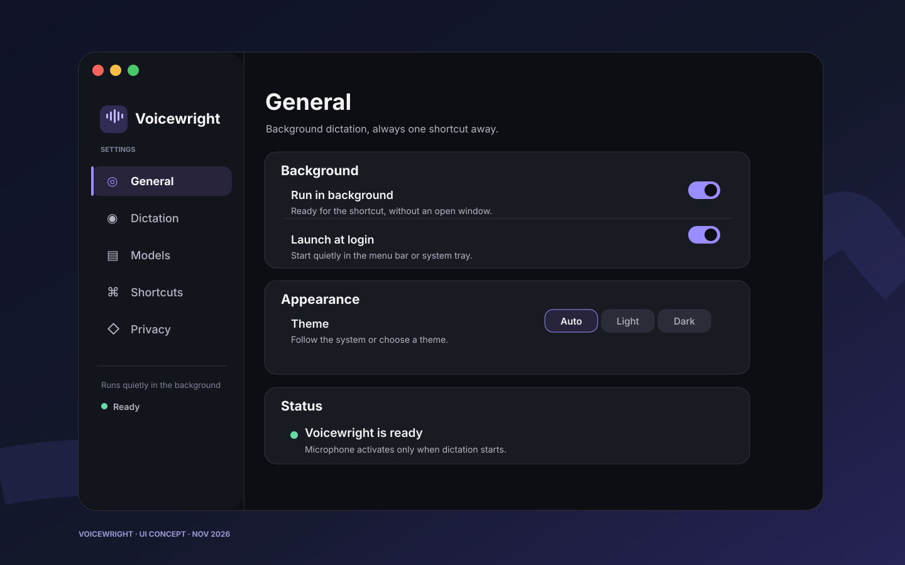
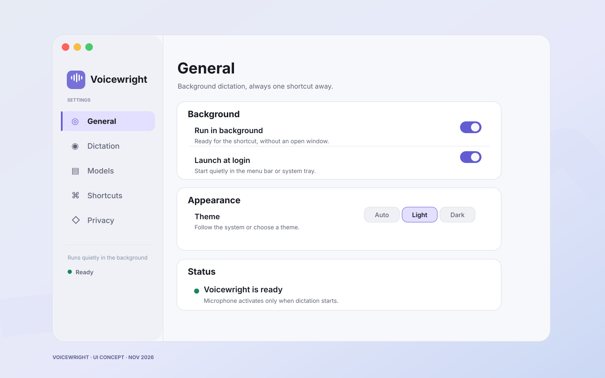
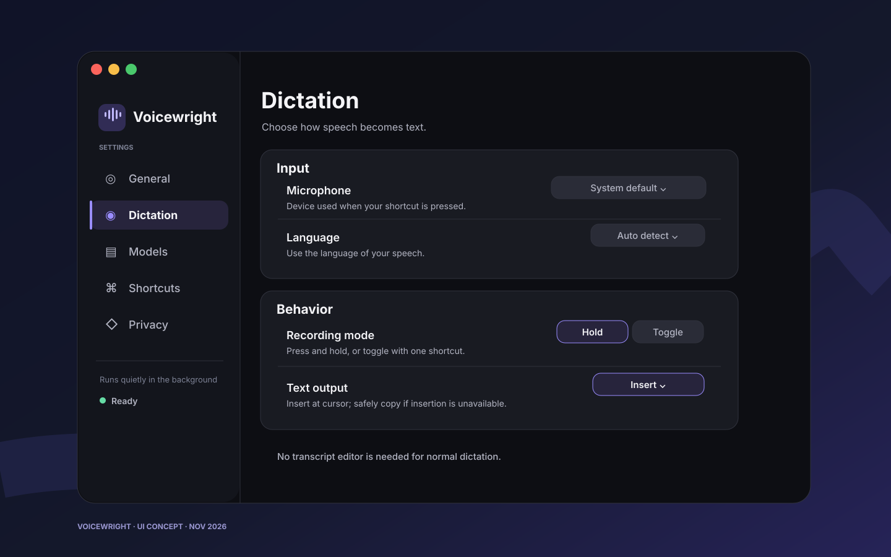
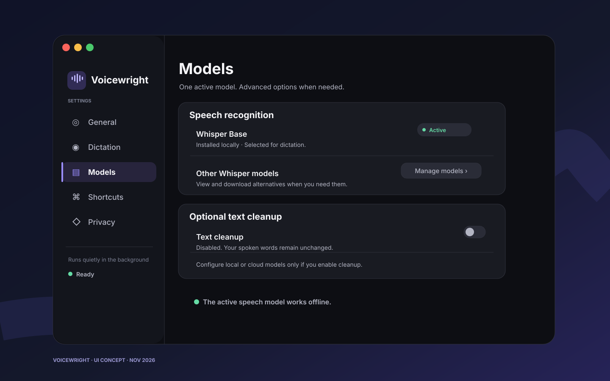
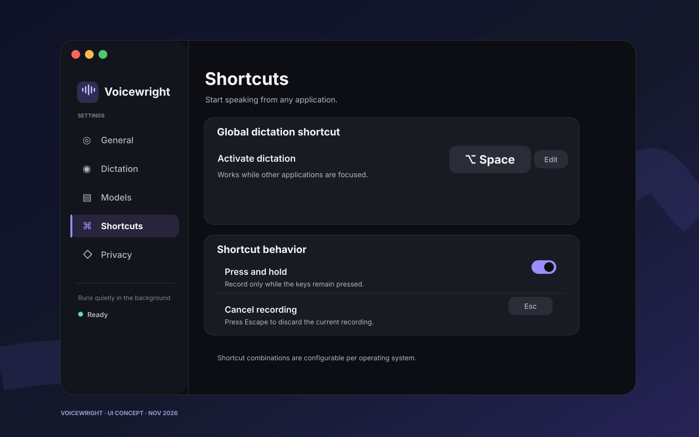
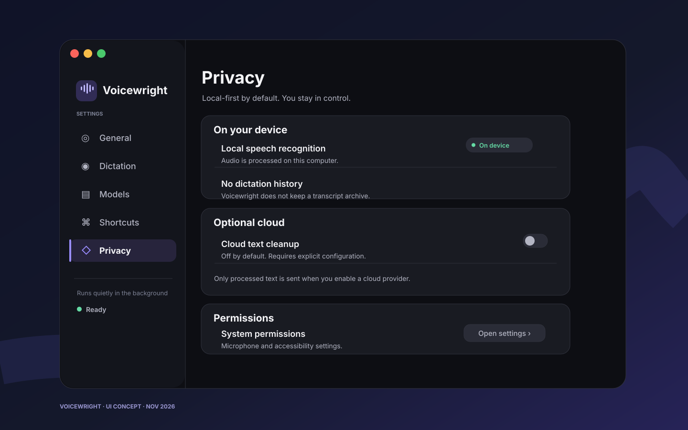
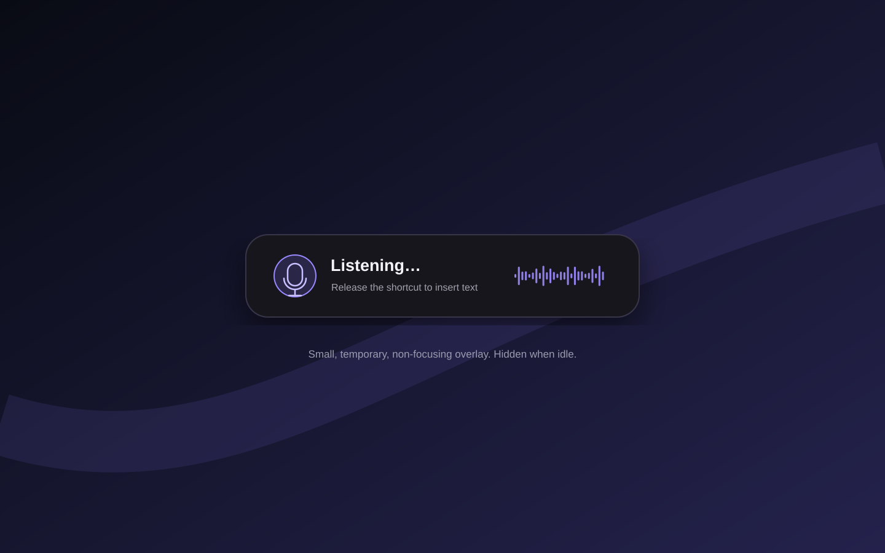
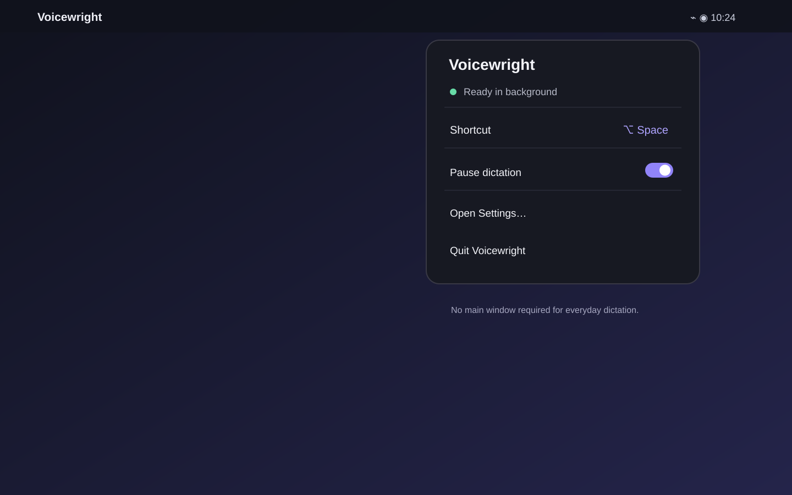

# Voicewright – verbindliches UI/UX-Konzept (November 2026)

> **V1-Pflichtreferenz ab 12.11.2026:** Diese Mockups bleiben der verbindliche minimalistische Look. Ein *virtuell* geprüfter V1-Testkandidat wird gemäß [V1_SCOPE.md](../V1_SCOPE.md) und [VIRTUAL_TESTING.md](../VIRTUAL_TESTING.md) gebaut; der Eigentümer prüft die tatsächliche Darstellung **erst am Ende** und gibt Feedback. Design-Mockups sind keine implementierten oder funktional geprüften Screens.

> **Freigegebenes Gestaltungsziel:** leise, minimalistische Desktop-Hintergrund-App. Globaler Hotkey → aufnehmen → lokal transkribieren → sicher einfügen bzw. kopieren. Das Hauptfenster ist **nur für Einrichtung und Einstellungen** gedacht, nicht als dauerhaftes Diktierstudio. Die Abbildungen sind **Design-Mockups**, keine Screenshots einer fertigen Implementierung.

## Mockups

Die Vektorgrafiken sind versioniert und dienen als visuelle Referenz für Aussehen, Hierarchie und Dichte. Sie sind bewusst **ohne** starke Transparenz und ohne das überladene Dashboard der früheren Entwürfe gestaltet.

| Bereich | Designreferenz |
| --- | --- |
| General – Dark | [SVG öffnen](mockups/general-dark.svg) |
| General – Light | [SVG öffnen](mockups/general-light.svg) |
| Dictation – Dark | [SVG öffnen](mockups/dictation-dark.svg) |
| Models – Dark | [SVG öffnen](mockups/models-dark.svg) |
| Shortcuts – Dark | [SVG öffnen](mockups/shortcuts-dark.svg) |
| Privacy – Dark | [SVG öffnen](mockups/privacy-dark.svg) |
| Aufnahme-HUD – Dark | [SVG öffnen](mockups/recording-hud-dark.svg) |
| Hintergrund-/Tray-Menü – Dark | [SVG öffnen](mockups/background-tray-dark.svg) |

### General – Dark und Light

### Dictation

### Models

### Shortcuts

### Privacy

### Kleine UI für den eigentlichen Alltag

## Leitlinien

1. **Keine Dashboard-Startseite.** Bei normalem Betrieb bleibt das Hauptfenster geschlossen. Im Tray/Menüleisten-Symbol ist der Zustand sichtbar; ein Klick öffnet ein kleines Menü mit Pause, Einstellungen und Beenden. Bei Systemstart kein automatisch öffnendes Hauptfenster.
2. **Maximal fünf Rubriken:** General, Dictation, Models, Shortcuts, Privacy. Technische Details in kontextbezogene Unterdialoge und Aufklappbereiche verschieben. Keine Wiederholung derselben Einstellung auf mehreren Seiten.
3. **General:** Hintergrundbetrieb, Autostart, Darstellung (System/Light/Dark), kompakter Status. Autostart ist eine bewusste Einstellung; Hintergrundbereitschaft bedeutet **nicht** dauerhaftes Zuhören.
4. **Dictation:** Mikrofon und Sprache, Hold/Toggle, Ausgabemodus. „Am Cursor einfügen“ nur dort anbieten, wo es sicher funktioniert; andernfalls verständlicher Copy-Fallback. Keine permanente Aufnahme oder große Transkript-Arbeitsfläche.
5. **Models:** gewähltes lokal installiertes Whisper-Modell prominent, alternative Modelle und Downloads hinter „Manage models“. Optionale Textkorrektur separat; Cloud-Korrektur ausschließlich nach ausdrücklich aktivierter Konfiguration.
6. **Shortcuts:** eine hervorgehobene globale Tastenkombination mit klarer Bearbeitung, darunter Hold-/Toggle-Verhalten und Abbruch per Escape. Shortcut nicht systemübergreifend identisch voraussetzen.
7. **Privacy:** lokale Transkription und kein dauerhaft gespeicherter Diktatverlauf als Standard. Auf Mikrofonrechte, optionalen Cloud-Modus und Systemberechtigungen verständlich verweisen. System-Keyring für API-Schlüssel; nichts heimlich an die Cloud senden.
8. **HUD:** während Recording/Processing/Error optional kleines **nicht fokussierendes** Overlay; beim Inaktivsein nicht sichtbar. Darf nie den ursprünglich fokussierten Editor überdecken oder Tastaturfokus abfangen. Fehlermeldungen und Copy-Fallback verfügbar. Sprachtext nicht ungefragt auf dem Overlay anzeigen.

## Design-Tokens / visuelle Regeln

- **Dark:** sehr dunkle, nahezu schwarze Flächen (Fenster circa `#0D0E13`, Seitenleiste `#13151C`, Karten `#191B22`), eindeutige weiße Typografie, Akzent nur sparsam in gedecktem Violett. Nicht in ein blaues, leuchtendes „Gaming“-Dark-UI kippen.
- **Light:** off-white/neutralgrau statt vollständig transparenter Flächen; dunkle, kontrastreiche Schrift.
- **Liquid Glass nur subtil:** kleine Menü-/Overlay-Oberflächen dürfen sanft translucide sein; Hauptinhalt überwiegend opak und ohne starken Blur. Transparenz darf nie Kontrast oder Lesbarkeit verschlechtern.
- **Typografie:** systemeigene UI-Schrift, klare Hierarchie, ruhige einheitliche Komponenten und konsistente Radien/Abstände. Keine übertriebenen Card-Stacks, großen Hero-Grafiken oder mehreren primären Buttons pro Ansicht.
- **Motion:** dezente 120–220 ms Übergänge für Hover, Menüs und Zustände; Aufnahmeindikator nur während aktiver Aufnahme bewegen. Kein kontinuierliches animiertes Hintergrundmuster. `prefers-reduced-motion`, High-Contrast und energiesparende Fallbacks beachten.
- **Plattform:** Apple-inspirierte Zurückhaltung, **keine** 1:1-Übernahme proprietärer Apple-Assets. Windows, macOS und Linux erhalten passende native Fensterelemente und systemgerechte Tray-/Menüleisten-Konventionen.
- **Zugänglichkeit:** Tastaturbedienung, sichtbarer Fokus, DE/EN-Lokalisierung, Screenreader, 200%-Skalierung, ausreichender Kontrast und sinnvolle kleine Fenster.
- **Leistung:** keine schweren UI-/Animation-Pakete für dekorative Effekte; Leerlauf-CPU/RAM/Latenz gegenüber dem Ausgangsstand messen.

## Abgleich mit dem tatsächlichen Produkt

Die Mockups veranschaulichen **Zielzustände**, nicht die bereits bewiesene Plattformunterstützung. Produktfunktionen und Einschränkungen aus `docs/PROGRESS.md`, `docs/PLATFORM_SUPPORT.md` und `AGENTS.md` gelten weiterhin. Insbesondere Einfügen, Autostart, Wayland und macOS-Verhalten müssen separat funktionsfähig gemacht und real getestet werden; keine UI darf Erfolg vortäuschen.

**Verwandte Issues:** #23 (UI/UX), #25 (HUD/Tray), #8 (Autostart/Hintergrundbetrieb), #22 (Onboarding), #24 (Accessibility), #3 (sichere Textinsertion).

**Umsetzung:** eigener Feature-Branch, PR gegen aktuelles `main`, kein direkter Push nach `main`. Erst Design-Tokens und Grundshell, dann Settings-Seiten, anschließend HUD/Tray; funktionale Backend-Logik nicht nebenbei ersetzen. Tests und Plattformunterschiede gemäß `AGENTS.md` dokumentieren.
